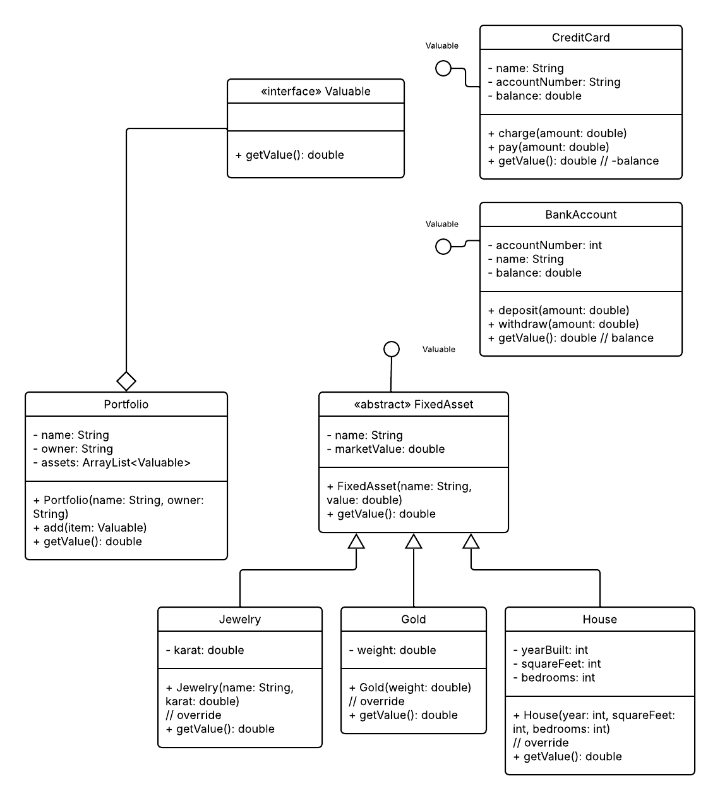

# Asset Portfolio – Class Diagram

**Workbook 6a · Exercise: Fixed Assets** (Year Up United – Java Development)

A UML class diagram for a portfolio app that estimates someone's **net worth**. The original portfolio only held fixed assets like houses and jewelry. This design expands it to also include **bank accounts** and **credit cards**.


---

## The Problem

A house, a bank account, and a credit card are very different things:

- A **house** has a market value, but you can't deposit money into it.
- A **bank account** changes often with deposits and withdrawals.
- A **credit card** is debt, so it should *lower* net worth.

`BankAccount` and `CreditCard` should **not** extend `FixedAsset`, but the portfolio still needs to add up all of them.

## The Solution: the `Valuable` Interface

```java
public interface Valuable {
    double getValue();
}
```

Every item that belongs in the portfolio implements `Valuable`:

| Class | How it implements `Valuable` | What `getValue()` returns |
|---|---|---|
| `FixedAsset` (abstract) | Implements it directly | Market value |
| `Jewelry`, `Gold`, `House` | Inherit it from `FixedAsset` | Their own calculated value |
| `BankAccount` | Implements it directly | The balance (**positive**) |
| `CreditCard` | Implements it directly | The balance as a **negative** (debt) |

## How the Portfolio Works

`Portfolio` keeps **one list** of `Valuable` items:

```java
private ArrayList<Valuable> assets;
```

To get the net worth, it asks each item for its value and adds them up. It doesn't need to know whether the item is a house, a bank account, or a credit card:

```java
for (Valuable item : assets) {
    total += item.getValue();
}
```

Because credit cards return a negative number, debt is subtracted automatically.

**Example:** $1,000 in the bank and $300 owed on a card gives `1000 + (-300) = $700` net worth.

## Key Design Choices

- **Interface instead of inheritance.** Java allows only one parent class but many interfaces, so unrelated classes can share a capability without being forced into the same family.
- **`FixedAsset` implements `Valuable` once,** so all its child classes get it for free.
- **No banking methods on assets.** `deposit`, `withdraw`, `charge`, and `pay` live only in the account classes.
- **Polymorphism.** The same method name, `getValue()`, gives a different result for each class.

## UML Legend

| Symbol | Meaning |
|---|---|
| Solid line + hollow triangle ▷ | **extends** (inheritance) |
| Lollipop ○ | **implements** an interface |
| Hollow diamond ◇ | Portfolio **holds** Valuable items (aggregation) |
| `-` / `+` | private / public |

## Tools

Diagram made in [Lucidchart](https://www.lucidchart.com/).
